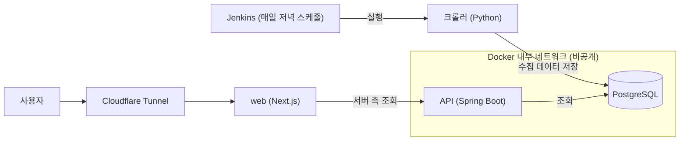

# 복싱의모든것 (boxing-commerce)

국내 복싱용품 쇼핑몰의 판매처별 가격을 한눈에 비교하는 가격 비교 서비스입니다.

- 라이브: https://boxingeverything.site
- 개인 서버에서 운영 중이라 간헐적으로 접속이 안 될 수 있습니다.

## 핵심 기능

- 국내 복싱용품 쇼핑몰 2곳의 상품을 매일 자동 수집해 판매처별 가격을 비교합니다.
- 카테고리·브랜드·가격 필터, 정렬, 페이지네이션, 검색을 지원합니다.
- 품절 상품은 재고 있는 판매처 기준으로 최저가를 계산하고, 상세 화면에서는 품절로 표시합니다.
- 가격이 바뀔 때만 이력을 기록하고, 상세 화면에서 최근 30일 가격 추이를 보여 줍니다.
- 주문·결제는 직접 처리하지 않고 판매처 링크로 연결합니다.

## 아키텍처



- 인터넷에 공개되는 것은 Cloudflare Tunnel을 거치는 web 하나뿐입니다.
- API와 DB는 Docker 내부 네트워크에만 있고, Jenkins도 외부에 노출하지 않습니다.

## 기술 스택

| 영역 | 기술 |
| --- | --- |
| Backend | Java 21, Spring Boot 4.1.1, Spring Data JPA (Hibernate), Flyway, springdoc-openapi 3.1.1, Gradle 8.14.6 |
| Frontend | Next.js 16.4.2 (App Router), React 19.3.0, TypeScript 5, Tailwind CSS 4, pnpm |
| Crawler | Python 3.12 이상, httpx, BeautifulSoup4 (lxml), psycopg 3, uv |
| DB | PostgreSQL |
| Infra | Docker, Docker Compose, Jenkins, Cloudflare Tunnel |

## 설계 포인트

- 수집 매너: 허용한 목록 페이지만 요청하고 robots.txt가 막은 경로는 거부합니다. 요청 간 대기, 순차 요청, 크롤러임을 밝히는 User-Agent를 씁니다.
- 수집 이상 감지: 요청 오류, 파싱 실패 비율, 직전 수집 대비 급감이면 그 회차를 실패로 마감하고 DB에 반영하지 않습니다.
- 멱등 수집: 같은 데이터를 다시 수집해도 중복 상품이나 가격 이력이 생기지 않습니다(판매처와 상품 번호 기준 upsert).
- 원본 보존 후 승격: 수집 원본(`raw_listing`)을 먼저 저장하고, 분류 규칙을 거쳐 상품·판매처 가격(`product`/`offer`)에 반영합니다.
- 품절 만료: 일정 기간 목록에서 보이지 않은 상품은 재고 없음으로 전환합니다.
- 스키마 소유: 스키마는 API의 Flyway가 단독으로 관리하고, 크롤러는 읽기·쓰기만 합니다.
- 최소 노출: 외부 공개는 web 하나뿐이고 API·DB·CI 서버는 인터넷에 노출하지 않습니다.

## 프로젝트 구조

```text
boxing-commerce/
├── apps/
│   ├── api/       Spring Boot 조회 API와 DB 마이그레이션(Flyway)
│   ├── web/       Next.js 프론트엔드
│   └── crawler/   Python 상품 수집·분류·DB 적재 크롤러(Jenkinsfile 포함)
├── deploy/        운영용 Docker Compose(api, web, 터널)와 배포 문서
├── docs/          설계 문서(ERD)
└── brand/         브랜드 원본 이미지
```

## 로컬 실행

사전 준비: PostgreSQL 17, JDK 21, Node.js와 pnpm, Python과 uv

### 1. DB 준비

```bash
psql -U postgres -c "CREATE USER boxing WITH PASSWORD '<password>';"
psql -U postgres -c "CREATE DATABASE boxing_commerce OWNER boxing;"
```

테이블은 API를 처음 실행할 때 Flyway가 만듭니다.

### 2. API

`apps/api/config/application-dev.example.yml`을 같은 폴더의 `application-dev.yml`로 복사해 접속 정보(`jdbc:postgresql://...`)를 채운 뒤 실행합니다. dev 프로파일은 데모 시드 데이터도 적용합니다.

```bash
cd apps/api
./gradlew bootRun --args='--spring.profiles.active=dev'
```

- 기본 포트 4001, health: http://localhost:4001/api/health
- 자세한 내용은 [apps/api/README.md](apps/api/README.md)

### 3. web

```bash
cd apps/web
pnpm install
pnpm dev
```

- 기본 포트 4000. API 주소는 환경변수 `API_BASE_URL`(기본값 `http://localhost:4001`)로 바꿉니다.
- 자세한 내용은 [apps/web/README.md](apps/web/README.md)

### 4. 크롤러 (선택)

```bash
cd apps/crawler
uv sync
cp .env.example .env   # CRAWLER_DB_* 값을 채웁니다
uv run --env-file .env python -m crawler --shop <어댑터 이름> --save
```

- `.env`는 git에서 제외됩니다. 어댑터 이름과 옵션, 인증서 설정은 [apps/crawler/README.md](apps/crawler/README.md)를 참고하세요.

### 운영용 Docker 스택

api·web 이미지를 만들어 Compose로 띄우는 방법은 [deploy/README.md](deploy/README.md)를 참고하세요.

## 문서

- [DB 설계 (ERD)](docs/erd.md)
- [API](apps/api/README.md), [web](apps/web/README.md), [크롤러](apps/crawler/README.md)
- [운영 배포](deploy/README.md)

## 로드맵 (미구현)

- 클릭 로그와 인기순 정렬 활성화 (`/go/[offerId]` 리다이렉트가 아직 없습니다)
- Jenkins 기반 CI/CD 배포 파이프라인
- 쇼핑몰 추가와, 같은 상품을 하나로 합치는 매칭
- 쇼핑몰별 배송비 정책 반영
