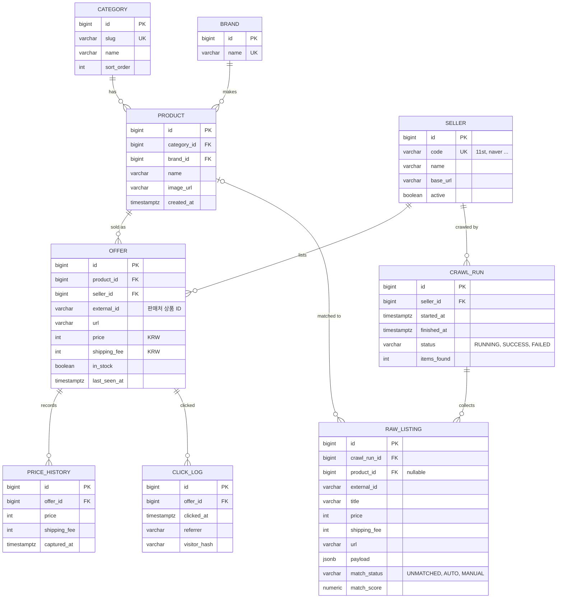

# DB 설계 (ERD)

복싱의모든것의 DB 설계 문서입니다. PostgreSQL 기준입니다.

## 범위

- **1차 구현 테이블**: `category`, `brand`, `product`, `seller`, `offer`, `price_history`, `click_log`
- **크롤링 수집 단계에서 추가 예정**: `crawl_run`, `raw_listing`

## ERD

> 다이어그램의 `varchar`는 길이를 생략한 표기입니다. 실제 길이와 NOT NULL 여부는 `V1__create_core_tables.sql`이 기준입니다. 모든 PK는 `bigint GENERATED ALWAYS AS IDENTITY`입니다.

## 설계 결정

- **offer와 raw_listing 분리**: raw_listing은 크롤링마다 쌓이는 원본 스냅샷, offer는 판매처별 현재 상태입니다. 매칭 로직을 고쳐도 원본으로 재처리할 수 있습니다.
- **상품 매칭은 raw_listing에서 수행**: `match_status`, `match_score`로 자동 매칭과 수동 확인 대상을 구분합니다.
- **price_history는 offer 단위로 적재**: 상세 페이지의 30일 차트는 일별 최저가 쿼리로 생성하고, 느려지면 일별 집계 테이블을 추가합니다.
- **offer는 `(seller_id, external_id)` unique**: 재수집 시 upsert합니다.
- **click_log에는 IP 원문을 저장하지 않고 `visitor_hash`만 저장**: 프론트 `/go/[offerId]`에서 기록합니다.
- **금액은 KRW 정수(int)로 저장**하고 `price`, `shipping_fee`에 `CHECK (>= 0)`를 둡니다. `shipping_fee`는 `NOT NULL DEFAULT 0`입니다.
- **FK 삭제 정책은 NO ACTION(기본값)**: 삭제 정책은 아직 정하지 않았습니다. 부모 행을 지우려면 자식 행을 먼저 지워야 합니다.
- **기본값**: `category.sort_order`는 `NOT NULL DEFAULT 0`, `offer.last_seen_at`은 `NOT NULL DEFAULT now()`입니다. `offer.in_stock`, `seller.active`는 `NOT NULL DEFAULT true`입니다.
- **NULL 허용 컬럼**: `product.image_url`(이미지가 없을 수 있음), `click_log.referrer`(리퍼러가 없는 유입), `click_log.visitor_hash`(식별값을 만들지 못한 경우)입니다.

## 인덱스와 제약

V1에 있는 것:

| 종류 | 이름 | 대상 |
| --- | --- | --- |
| Unique | `uq_category_slug` | `category(slug)` |
| Unique | `uq_brand_name` | `brand(name)` |
| Unique | `uq_seller_code` | `seller(code)` |
| Unique | `uq_offer_seller_external` | `offer(seller_id, external_id)` |
| CHECK | `ck_offer_price` | `offer.price >= 0` |
| CHECK | `ck_offer_shipping_fee` | `offer.shipping_fee >= 0` |
| CHECK | `ck_price_history_price` | `price_history.price >= 0` |
| CHECK | `ck_price_history_shipping_fee` | `price_history.shipping_fee >= 0` |
| Index | `idx_product_category_brand` | `product(category_id, brand_id)` |
| Index | `idx_product_brand` | `product(brand_id)` — 복합 인덱스의 선두가 `category_id`라서 `brand_id` 단독 조회용으로 추가 |
| Index | `idx_offer_product_price` | `offer(product_id, price)` |
| Index | `idx_price_history_offer_captured` | `price_history(offer_id, captured_at)` |
| Index | `idx_click_log_offer_clicked` | `click_log(offer_id, clicked_at)` |

FK 제약은 `fk_<테이블>_<참조 대상>` 형식입니다 (`fk_product_category`, `fk_product_brand`, `fk_offer_product`, `fk_offer_seller`, `fk_price_history_offer`, `fk_click_log_offer`).

크롤링 단계에서 추가 예정 (V1에 없음):

- `raw_listing(match_status)`
- `crawl_run`, `raw_listing` 테이블의 FK와 기타 제약
